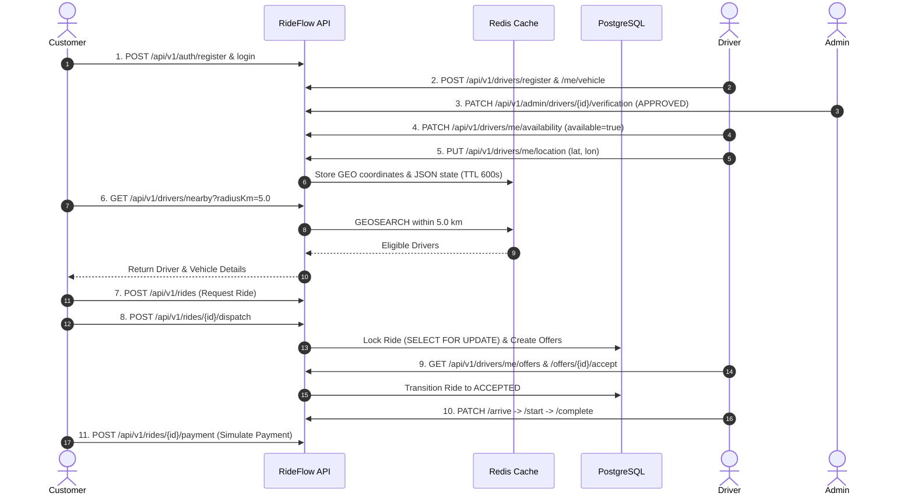

# RideFlow — Real-Time Ride Booking & Dispatch Backend

[](https://www.oracle.com/java/)
[](https://spring.io/projects/spring-boot)
[](https://www.postgresql.org/)
[](https://redis.io/)
[](https://junit.org/)

RideFlow is a high-performance, real-time ride hailing and dispatch backend engineered in **Java 21** and **Spring Boot 3.3**. It showcases production-grade backend design patterns: Role-Based Access Control (RBAC), Redis-backed geospatial driver discovery, WebSocket STOMP real-time telemetry, pessimistic concurrency locking for ride dispatch, state-machine ride lifecycle orchestration, and RFC 7807 compliant error handling.

---

## Key Architectural Highlights

* **Geospatial Discovery & Telemetry**: Driver locations are ingested into a Redis Geospatial Index (`GEOADD` / `GEOSEARCH`) with TTL-based state caching (`rideflow:drivers:loc:{driverId}`). Automatic cleanup handles stale driver coordinates, with a zero-downtime in-memory fallback.
* **Concurrency & Race Condition Prevention**: Ride acceptance and driver offer claims utilize pessimistic database locking (`SELECT FOR UPDATE`) to prevent double-booking, race conditions, or duplicate offers under high contention.
* **Transaction-Bound WebSocket Events**: STOMP over SockJS (`/ws`) publishes location updates and ride offer events using `@TransactionalEventListener(phase = AFTER_COMMIT)`, guaranteeing real-time messages are never broadcast if the enclosing database transaction rolls back.
* **Robust RBAC & Security**: Stateless JWT architecture (JJWT 0.12.x) with custom Spring Security filter chains strictly isolating `CUSTOMER`, `DRIVER`, and `ADMIN` privileges.
* **Automated Data Migrations**: PostgreSQL schema versioning managed through Flyway (V1–V8), enforcing relational integrity, foreign keys, and unique indexes.

---

## Tech Stack

| Layer | Technologies |
| :--- | :--- |
| **Language & Platform** | Java 21 (Oracle JDK 21 / OpenJDK 21) |
| **Framework** | Spring Boot 3.3.5 (Web, Data JPA, Data Redis, Security, WebSocket, Actuator) |
| **Databases** | PostgreSQL 17 (primary relational store), Redis Alpine (geospatial index & cache) |
| **Security** | Spring Security 6, JJWT 0.12.6 (HMAC-SHA256) |
| **Database Migrations** | Flyway 10 |
| **API Documentation** | SpringDoc OpenAPI 3 / Swagger UI 2.6 |
| **Build & Testing** | Maven 3.9 (Wrapper included), JUnit 5, MockMvc, H2 (isolated in-memory test suite) |

---

## Architecture Overview

```
                          ┌──────────────────────────┐
                          │   Client Application     │
                          └───────────┬──────────────┘
                                      │ REST (HTTP/JSON) & WebSockets (/ws)
                                      ▼
                          ┌──────────────────────────┐
                          │   Spring Boot 3.3 API    │
                          │  (Security Filter Chain) │
                          └─────┬────────────────┬───┘
                                │                │
        PostgreSQL 17           │                │          Redis
 ┌──────────────────────────┐   │                │   ┌──────────────────────────┐
 │ Users, Drivers, Vehicles │◄──┘                └──►│ rideflow:drivers:geo     │
 │ Rides, Offers, Payments  │ (Spring Data JPA)      │ (GEOADD / GEOSEARCH)     │
 │ (Flyway Migrations V1-V8)│                        │ rideflow:drivers:loc:*   │
 └──────────────────────────┘                        └──────────────────────────┘
```

---

## Prerequisites

* **Java 21**: JDK 21 installed and configured on your `PATH`.
* **Maven 3.9+**: Or use the included cross-platform Maven Wrapper (`.\mvnw.cmd` on Windows, `./mvnw` on Linux/macOS).
* **PostgreSQL 15+**: Local PostgreSQL instance for running the application.
* **Docker / Redis**: Local Redis instance on port 6379 (e.g., Docker `redis:alpine`).
* **Zero Paid Services**: All dependencies run locally without third-party or paid cloud services.

---

## Local Setup & Quick Start

### 1. Start Local Redis (Docker)

```bash
docker run -d --name rideflow-redis -p 6379:6379 redis:alpine
```

### 2. Configure Local PostgreSQL

Create the local development database and dedicated user in PostgreSQL:

```sql
CREATE DATABASE rideflow_db;
CREATE USER rideflow WITH PASSWORD 'your_secure_password';
GRANT ALL PRIVILEGES ON DATABASE rideflow_db TO rideflow;
```

### 3. Run Automated Tests

The automated test suite runs against an isolated, in-memory H2 database with Redis mocked, requiring no external databases:

```powershell
# Windows
$env:JAVA_HOME = "C:\Program Files\Java\jdk-21.0.12.1"
.\mvnw.cmd test

# Linux / macOS
export JAVA_HOME="/path/to/jdk-21"
./mvnw test
```
*Current suite status: **217 passed, 0 failures, 0 skipped**.*

### 4. Run the Application

Both `DB_PASSWORD` and `JWT_SECRET` must be supplied via environment variables. For security, no fallback credentials or default signing keys are hardcoded in application properties; the application will halt on startup if either is missing.

> [!IMPORTANT]
> Never hardcode or commit real passwords or JWT signing keys to version control. Pass credentials dynamically at runtime via environment variables as shown below:

```powershell
# Windows PowerShell
$env:JAVA_HOME = "C:\Program Files\Java\jdk-21.0.12.1"
$env:DB_URL = "jdbc:postgresql://localhost:5432/rideflow_db"
$env:DB_USERNAME = "rideflow"
$env:DB_PASSWORD = "your_local_db_password"
$env:JWT_SECRET = "your-custom-256-bit-secret-key-at-least-32-chars-long!"
.\mvnw.cmd spring-boot:run
```

```bash
# Linux / macOS
export JAVA_HOME="/path/to/jdk-21"
export DB_URL="jdbc:postgresql://localhost:5432/rideflow_db"
export DB_USERNAME="rideflow"
export DB_PASSWORD="your_local_db_password"
export JWT_SECRET="your-custom-256-bit-secret-key-at-least-32-chars-long!"
./mvnw spring-boot:run
```

---

## Verification & API Documentation

Once launched, access the interactive OpenAPI documentation and system health monitors:

* **Interactive Swagger UI**: [http://localhost:8080/swagger-ui.html](http://localhost:8080/swagger-ui.html)
* **OpenAPI 3 JSON Spec**: [http://localhost:8080/api-docs](http://localhost:8080/api-docs)
* **Spring Actuator Health**: [http://localhost:8080/actuator/health](http://localhost:8080/actuator/health)
* **WebSocket Endpoint**: `ws://localhost:8080/ws`

---

## End-to-End Demo Flow

Follow this sequence to test the complete lifecycle via Swagger UI or curl:



1. **User Registration & Login**: `POST /api/v1/auth/register` and `POST /api/v1/auth/login` to obtain JWT Bearer tokens.
2. **Driver Onboarding**: Driver creates profile (`POST /api/v1/drivers/register`) and registers vehicle details (`POST /api/v1/drivers/me/vehicle`).
3. **Admin Verification**: Administrator approves the driver profile (`PATCH /api/v1/admin/drivers/{driverId}/verification`).
4. **Driver Availability**: Driver enables active dispatch status (`PATCH /api/v1/drivers/me/availability` with `{"available": true}`).
5. **Real-Time Location Tracking**: Driver streams GPS coordinates via `PUT /api/v1/drivers/me/location`. Coordinates are indexed directly into Redis.
6. **Nearby Driver Discovery**: Customer searches for available vehicles within radius via `GET /api/v1/drivers/nearby?latitude=12.9716&longitude=77.5946&radiusKm=5.0`.
7. **Ride Creation & Dispatch**: Customer requests a ride (`POST /api/v1/rides`) and triggers dispatch matching (`POST /api/v1/rides/{rideId}/dispatch`).
8. **Offer Acceptance & Ride Lifecycle**: Driver reviews offers (`GET /api/v1/drivers/me/offers`), accepts (`POST /api/v1/offers/{offerId}/accept`), marks arrival, starts trip, completes trip, and payment simulation is verified.

---

## Environment Variables

| Variable | Default Value | Description |
| :--- | :--- | :--- |
| `DB_URL` | `jdbc:postgresql://localhost:5432/rideflow_db` | JDBC connection URL for PostgreSQL |
| `DB_USERNAME` | `rideflow` | PostgreSQL database user |
| `DB_PASSWORD` | *(Required)* | PostgreSQL database password (no default fallback) |
| `JWT_SECRET` | *(Required)* | HMAC-SHA256 signing secret key (minimum 32 characters / 256 bits) |
| `REDIS_HOST` | `localhost` | Redis server hostname |
| `REDIS_PORT` | `6379` | Redis server port |
| `REDIS_ENABLED` | `true` | Enable or disable Redis geospatial caching |
| `SERVER_PORT` | `8080` | Application HTTP listening port |

---

## Development Roadmap & Status

* [x] **Phase 1: Core Backend** — Modular Spring architecture, JWT security, user/driver profiles, fare estimation, ride lifecycle state transitions, payments, H2 integration tests.
* [x] **Phase 2: Real-Time Engine** — Redis geospatial indexing & driver discovery, dispatch offer state machine, cascading re-dispatch recovery, WebSocket/STOMP live telemetry. *(Live verified)*
* [ ] **Phase 3: Production & Enterprise Scale** — Clustered message broker relay (RabbitMQ/Kafka), push notification integration (FCM/APNS), multi-instance container orchestration.

---

## License

This project is licensed under the MIT License — see the [LICENSE](LICENSE) file for details.
